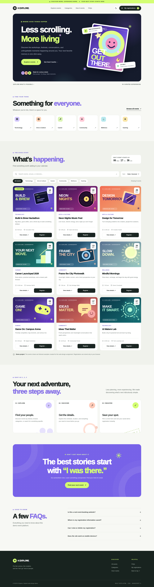
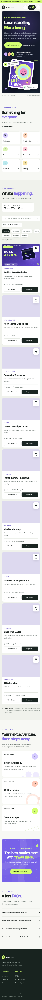

# K Explore ✳ — Responsive Event Management Website

**K Explore** is a colorful, responsive event-discovery and **demo registration** website created for the **K Explore – Web Designing elective**. Browse events, search by keyword, filter by category, view full event details, and save registrations in your own browser.

> **Important:** The listed events, venues, dates, and registration confirmations are fictional examples for an academic project. This is a front-end-only demo: no real seats are booked, no registration emails are sent, and no user data is submitted to an event organizer.

## Preview

| Desktop — light mode | Mobile — responsive layout |
| --- | --- |
|  |  |

Dark mode preview: [View screenshot](screenshots/desktop-dark.png)

## Features

- **Attractive home page** — hero section, themed illustrations, featured/upcoming events, responsive navigation, and strong calls to action.
- **9 illustrated events in 6 categories** — every event shows a poster, name, date, time, venue, and short description.
- **Live event search** — filters by title, category, venue, location, description, and interests.
- **Category filters and sorting** — Technology, Arts & Culture, Career, Community, Wellness, Gaming; sort by date or A–Z.
- **Event details modal** — full description, date/time, venue, duration, event agenda, and tags.
- **Registration form** — collects full name, email, phone, and selected event with custom JavaScript validation and accessible error messages.
- **Instant confirmation** — displays a locally generated demo reference number and event details after a successful save.
- **My registrations** — view, remove, and export saved demo registrations as CSV.
- **Bonus: localStorage** — saved registrations and theme preference persist after refresh on the same browser/device.
- **Bonus: light/dark mode, countdown timer, hover animations** — no external JS libraries needed.
- **Responsive design** — built for mobile, tablet, and desktop; keyboard-friendly dialogs, semantic HTML, and reduced-motion support.
- **Self-contained artwork** — all poster images are bundled as SVG files; no external image service is needed.

## Technology Used

| Area | Technology |
| --- | --- |
| Page structure | HTML5 |
| Styling & responsive layouts | CSS3: Grid, Flexbox, media queries, custom properties |
| Functionality & validation | Vanilla JavaScript (ES6+) |
| Registration storage | Browser `localStorage` (no back end) |
| Vector art | Local SVG images |
| Version control & hosting | Git / GitHub + GitHub Pages (or Netlify / Vercel) |

**No npm installation, React project setup, API key, or database is required.**

## Folder Structure

```text
K-Explore-Event-Website/
├── index.html             # Page structure, dialogs, semantic HTML
├── styles.css             # Visual styles, dark theme, responsive design
├── data.js                # Fictional event catalogue and categories
├── app.js                 # Filters, dialogs, form, localStorage, countdown
├── assets/                # Custom SVG event posters and favicon
├── screenshots/           # Desktop, mobile, and dark-mode previews
├── README.md              # Overview, setup, functionality
├── PROJECT_REPORT.md      # Objectives, implementation, requirements mapping
├── SUBMISSION_GUIDE.md    # How to publish with GitHub and GitHub Pages
└── .gitignore
```

## How to Run Locally

### Option A — VS Code / Live Server

1. Download and extract this project folder.
2. Open the folder in **Visual Studio Code**.
3. Install the **Live Server** VS Code extension if necessary.
4. Right-click `index.html` → **Open with Live Server**.
5. Explore the website in your browser.

### Option B — Python static server

From a terminal opened **inside the project folder**:

```bash
python -m http.server 5500
```

Then open **http://localhost:5500** in your browser. Stop the server with **Ctrl+C**. The site can also be opened directly through `index.html` in most modern browsers, but serving the files locally is recommended.

## How to Use the Website

1. Scroll to **What's happening** or select **Explore events**.
2. Search for an event or select a category, such as **Technology**.
3. Select **View details** for the full schedule, venue, and description.
4. Select **Register**, enter your name, email, and phone, and submit the form.
5. See your on-screen **demo confirmation** and reference code.
6. Select **My registrations** to view, remove, or export saved entries.
7. Use the moon/sun button to switch between light and dark mode.

### JavaScript Form Validation

| Field | Validation |
| --- | --- |
| Full name | Required, 2–80 characters, accepts Unicode letters, spaces and common name punctuation |
| Email | Required, must match a typical `name@domain.extension` format |
| Phone | Required, allows common separators and optional `+`, must contain 10–15 digits |
| Event | Required, must match an event in `data.js` |
| Duplicate submission | The same email cannot save the same event twice in this browser |

Errors appear under the relevant field, with `aria-invalid` set for accessibility. The page shows a confirmation only **after** validation succeeds and the browser confirms the save.

## Changing Event Data

Edit the event objects in `data.js` to change the sample catalogue. Each entry contains an `id`, `title`, `category`, `date` (ISO 8601 with offset), `venue`, `location`, `duration`, `image`, `shortDescription`, `description`, `agenda`, and `tags`.

Make sure each `id` is unique and that the corresponding illustration exists inside `assets/`. The website currently formats event times in **Asia/Kolkata**.

## How Storage Works / Privacy

Registrations are stored using the key `kexplore-registrations-v1`; theme preference uses `kexplore-theme-v1`. Data stays **only in the current browser's localStorage**. Clearing browser site data will remove the registrations, and they are not synchronized between devices. Users can also delete an entry from **My registrations**.

This is appropriate for demonstrating front-end functionality, **not for production event registration or storing sensitive personal information**. Real deployment would require a back end, proper authentication, a database, data-protection measures, and transactional confirmation.

## Publishing & Submitting

The assignment requires both a **GitHub repository URL and a deployed website URL**, with a README. The complete publishing commands and GitHub Pages instructions are in [SUBMISSION_GUIDE.md](SUBMISSION_GUIDE.md).

**Repository URL:** _Add your GitHub URL after pushing_  
**Live website URL:** _Add your deployed URL after publishing_

## Testing

The interface and interactions have been checked in a headless Chromium test environment with in-memory browser storage, including: rendering all event cards and local SVG images, search and filtering, event details, invalid/valid form submissions, confirmation, saving/removing entries, CSV export, dark mode, mobile menu, and mobile horizontal-overflow checks.

For final submission, also test your **deployed URL** in Chrome or Edge, including at least one real registration saved in that browser and a reload to confirm persistence.

## Assignment Coverage

See [PROJECT_REPORT.md](PROJECT_REPORT.md) for a requirement-by-requirement mapping to the source code, key implementation details, and a final testing checklist.

---

**Made with HTML5, CSS3, JavaScript, and a lot of creative energy.** ✳
